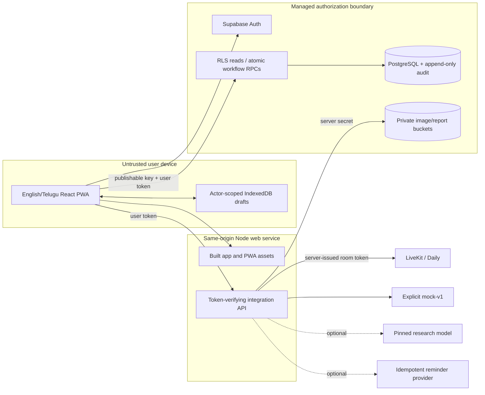
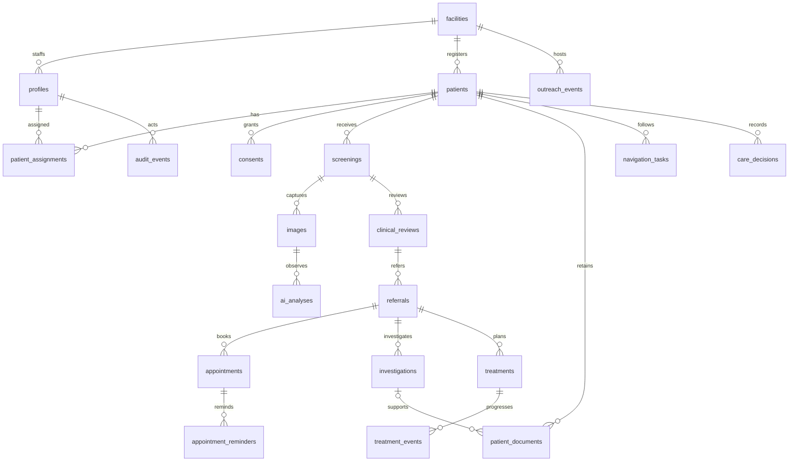

# Product scope and architecture

The goal is one understandable synthetic screening-to-care record, shared by five
authorized roles, usable in English/Telugu and resilient to interrupted registration.
The handbook permits an alternative stack: this app uses React/TypeScript/Vite PWA,
Node, Supabase Auth/PostgreSQL/private Storage, and a LiveKit/Daily video adapter.

Success means a worker can register and capture consented images; a clinician can
independently sign a review/referral; assigned staff can book and complete a test
consultation, record simulated pathology, follow-up and treatment; an administrator
can see updated aggregates without patient records. AI is a labelled optional mock
or evaluated research integration and cannot make a clinical decision.

The browser is never trusted to set a role or bypass patient assignment. Supabase
checks active profile and assignment on reads and writes. The Node API independently
verifies the bearer token and file/video consent. Provider and service secrets stay
on the server. Application assets are cached by the PWA; private files and cloud
responses are not cached for offline reading.

The diagram summarizes relations; SQL migrations define the exact foreign keys and
allowed transitions. `app_private.workflow_requests` is the private idempotency ledger,
not an exposed application table. Registration keeps its UUID across offline retries;
clinical updates carry revisions. Uploads use stable file/destination identities and
resume a private object when metadata confirmation was interrupted.

The [role matrix](SUPABASE_SETUP.md), [API/OpenAPI](API_CONTRACT.md),
[threat model](SECURITY_AND_RECOVERY.md), [model/data card](MODEL_AND_DATASET_CARD.md)
and [test report](TEST_REPORT.md) specify the trust boundaries and their practical limits.
