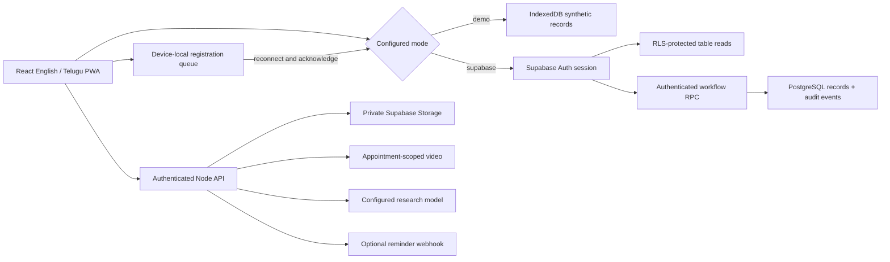

# Implementation

## Architecture

`src/lib/client.ts` contains the Supabase adapter. `src/lib/demo.ts` is a synthetic
simulation, not a security boundary. Its whole dataset lives in the browser; role
filtering demonstrates the interface. Supabase authorization runs in PostgreSQL.

`src/lib/use-workspace.ts` coordinates sessions, reads, writes and retries. Queue
entries are scoped to mode and actor. Registration UUIDs survive retries, and queue
entries disappear only after successful writes. Other clinical edits require
connectivity; stale clinician notes are never silently queued for overwrite.

The service worker caches static application assets only. It does not cache
Supabase API responses or private images. Fonts are bundled locally. No tracking,
analytics or remote font scripts are loaded.

## Demo journey

1. As Health worker, register a synthetic patient with screening and photo consent.
2. Open Oral photographs and upload a synthetic image. A flat image requests
   recapture; acceptable quality enables the explicitly labelled mock AI.
3. Switch to Medical Officer, find the record, and sign an independent referral.
   AI is optional and never blocks the clinical review.
4. Book an appointment. Booking and video-service availability are separate.
5. As Navigator, mark attendance/missed attendance and complete a follow-up task.
6. As a clinician, enter a simulated diagnostic outcome.
7. As District admin, view aggregate counts and export a summary CSV.
8. In production preview, disconnect, register, reload, reconnect, and verify the
   record appears once. Demo acknowledges a local write; verify actual server
   acknowledgement separately after configuring Supabase.

## Added care workflows

The patient **Care plan** tab tracks biopsy/pathology investigations, attaches PDF/JPEG
reports and records treatment plans with append-only progress events. Clinician-only
records are filtered from worker/navigator/admin views and protected by database RLS.
Consent changes append a new history event; current consent controls file and video access.

Appointments support rescheduling, cancellation, in-app reminders and calendar downloads.
Rescheduling checks stale times and clinician conflicts, cancels old pending reminders
and creates a new one. Treatment updates check revision numbers. The cloud RPC retry
ledger prevents duplicate mutations. External reminder delivery uses leased jobs and
requires an idempotent provider configured explicitly on the server.

District reports include completed/all follow-up tasks, completion rate, outreach events,
attendance/screening totals and active treatments. Admins receive aggregate values only.
Existing device-local demo data is upgraded without discarding patients or drafts.

`server/index.mjs` supplies session-verified file, Daily video and research-model endpoints.
`server/validation.mjs` decodes files and validates model output. No configured service
is emulated as a successful live call. See [integration setup](INTEGRATIONS.md).

## Remaining setup and verification

The nine-step patient journey is implemented in `src/PatientJourney.tsx`. Shared
record derivation in `src/lib/journey.ts` drives stage indicators, closure checks
and the local summary. Migration 005 implements the matching PostgreSQL behavior.
Pending investigations take precedence over treatment in the overall stage so that
an unresolved result stays visible. Only a clinician can close or reopen a case.
Closure requires resolved scheduled appointments, investigations, active treatments
and follow-up tasks; referred cases without procedures need signed “not required”
decisions. Decisions are append-only. Closed cases reject new care edits and uploads.
AI remains optional and a mock result is never displayed as completed real analysis.
See the [demo runbook](DEMO_RUNBOOK.md) for an end-to-end acceptance walkthrough.

1. Configure hosted Supabase and verify each account's access through the Data API.
2. Configure the Node API and test private image/report access against hosted Storage.
3. Configure Daily and test two accounts on separate devices; verify camera/microphone behavior.
4. Staff assignments currently use Supabase administration. Optional operational
   extensions include self-service staff administration and immediate provider-token revocation.
5. Calibrate image-quality checks on licensed media. A research classifier remains
   optional and needs proper dataset splits, evaluation and model/dataset cards.
6. Test real Android camera/installability, MFA, conflicts, backup/restore and recovery.
7. Record the team's demonstration video and contribution statement using the
   included architecture, runbook, known limitations and generated test evidence.

Only synthetic data is permitted. This is not a complete clinical application.
